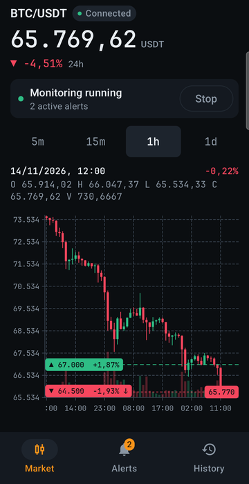
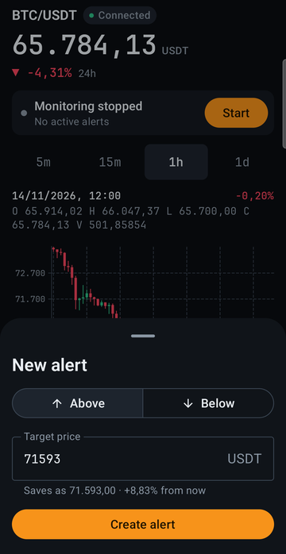
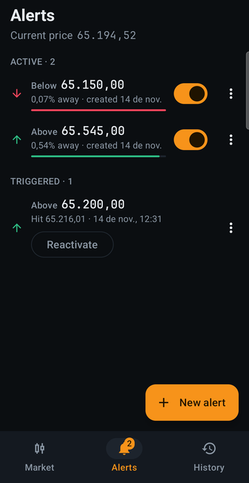
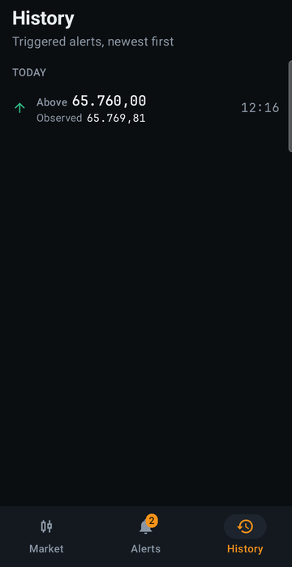

# bitcoin-alert

A lightweight, personal Android application for monitoring Bitcoin prices in real time through the
Binance public market API: live BTC/USDT price, candlestick charts and local price alerts. No
backend, no accounts, no analytics. Distributed as a signed APK through GitHub Releases.

Status: in development; `v0.*` releases are test builds. See [`docs/spec.md`](docs/spec.md) for the
requirements and [`docs/roadmap.md`](docs/roadmap.md) for the implementation phases.

<p>
  
  
  
  
</p>

## Install

Requires Android 8.0 (API 26) or newer.

1. Download `bitcoin-alert-vX.Y.Z.apk` and `bitcoin-alert-vX.Y.Z.apk.sha256` from the
   [Releases](https://github.com/allisson/bitcoin-alert/releases) page.
2. Check the download, in the folder with both files:

   ```bash
   sha256sum -c bitcoin-alert-vX.Y.Z.apk.sha256       # Linux
   shasum -a 256 -c bitcoin-alert-vX.Y.Z.apk.sha256   # macOS
   ```

   The checksum only detects a corrupted download: it is published next to the APK.
3. Optionally, check who signed it. The signing certificate's SHA-256 fingerprint is:

   ```text
   FC:DF:A2:38:94:43:6F:FE:D0:DF:9A:7A:A8:DF:04:FC:4F:29:64:FA:7E:29:F1:43:56:E3:98:9A:8A:40:A6:70
   ```

   ```bash
   apksigner verify --print-certs bitcoin-alert-vX.Y.Z.apk   # Android SDK build-tools
   ```

   `Signer #1 certificate SHA-256 digest` must match it (lowercase, without colons).
4. Open the APK on the phone and allow your browser or file manager to install unknown apps when
   Android asks.

A newer release installs over the previous one and keeps your alerts and history. Every release is
signed with the same key; an APK signed with another key fails to install as an update.

From 2027 Android requires apps installed outside Google Play to come from a verified developer.
The application ID will be registered before `v1.0.0` (`docs/spec.md` §6).

## Permissions

| Permission | Why |
|---|---|
| Internet, network state | Binance price stream and candles; reconnect as soon as the network changes. |
| Foreground service (special use) | Keep monitoring alerts while the app is in the background. |
| Notifications (Android 13+) | The monitoring notification and the alert notifications. Asked when you start monitoring or create an alert. |
| Ignore battery optimization | Only when you tap **Allow** on the battery warning on Home. Never requested on its own. |

The app has no account, sends nothing about you anywhere, and keeps its data out of Android backups.

## How monitoring works

- Alerts are checked only while monitoring runs. Tap **Start** on Home; a persistent notification
  ("Monitoring BTC/USDT") shows it is running, with a **Stop** action.
- An alert triggers when the price crosses its target (Above or Below), not when it is already past
  it. It triggers once, is recorded in History and posts a notification. Reactivate it to watch the
  target again.
- Monitoring keeps running with no active alerts; only you stop it.
- Home shows the monitoring state: Stopped, Running, or Interrupted when you started it and Android
  stopped it. Tap **Start** again after an interruption.

## Notifications

There are two notification channels, set in Android's settings for the app:

- **Monitoring** (low importance): the persistent notification. On Android 14+ you can swipe it
  away; monitoring keeps running.
- **Price alerts** (high importance): one notification per triggered alert, with sound and
  vibration. Change the sound, vibration or importance in the channel settings.

If notifications are off for the app or the Price alerts channel is blocked, alerts are still
recorded in History, and Home shows a warning with a shortcut to the settings.

## Known limitations

Android does not guarantee that a background app keeps running. Tested on a Samsung Galaxy A54 (One
UI 8.5):

- Stopping the app from the Task Manager, or the system killing its process, stops monitoring and
  Android does not restart it. Home shows Interrupted until you tap **Start**.
- Monitoring does not restart after the phone reboots.
- Battery optimization can pause monitoring with the screen off. Tap **Allow** on the battery warning
  on Home, and on Samsung phones keep the app out of "Sleeping apps".
- Binance closes the price connection every 24 hours; the app reconnects at once. A crossing during a
  network outage triggers on the first price after reconnecting.
- If the process dies right after an alert triggers, its notification can be lost; the trigger is
  still in History.

## Build and test

Requirements:

- JDK 21 (Temurin), pinned in `.tool-versions`.
- Android SDK with platform 37. Point Gradle to it with `ANDROID_HOME` or with
  `sdk.dir=<path>` in `local.properties` (not committed).

```bash
./gradlew assembleDebug          # debug APK (application ID io.github.allisson.bitcoinalert.debug)
./gradlew testDebugUnitTest      # all JVM tests: unit, Robolectric and MockWebServer
./gradlew -p buildSrc test       # build logic tests (version from the release tag)
./gradlew assembleRelease        # unsigned Release APK; only the release workflow signs it
```

The debug build installs next to the release build, with its own data.

## Release process

1. Merge to `main` with CI green.
2. Tag the commit and push the tag:

   ```bash
   git tag vX.Y.Z
   git push origin vX.Y.Z
   ```

   Tags are `vMAJOR.MINOR.PATCH` with MINOR and PATCH from 0 to 99 and no leading zeros;
   `versionCode` is `MAJOR * 10000 + MINOR * 100 + PATCH`, so every tag uses up a version. `v0.*`
   tags are published as pre-releases; test only with them, never with a `v1.x` tag.
3. The [Release workflow](.github/workflows/release.yml) runs the tests, builds and signs the APK,
   checks the signature, writes the checksum and creates the GitHub release with both files.

The signing key and its password live outside the repository, backed up in the maintainer's password
manager; GitHub Actions gets them from the `KEYSTORE_BASE64`, `KEYSTORE_PASSWORD` and `KEY_ALIAS`
secrets. Losing the key means no future release can update an existing installation.

## License

[MIT](LICENSE)
